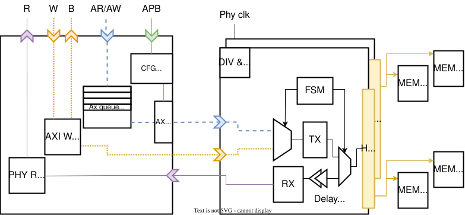

# HyperBus v2

This peripheral implements an AXI4-compliant interface for the HyperBus protocol, described [in its specification](https://www.cypress.com/file/213356/download). HyperBus v2 is part of the [PULP (Parallel Ultra-Low-Power) platform](https://pulp-platform.org/).

Hyperbus is mainly used for off-chip memories (HyperFlash and HyperRAM), but also supported by some generic peripherals.

## Features

The AXI data widths are parameterizable from 16 to 1024, with transfers of all sizes possible. Each PHY exposes four chip selects; unused chip records can be disabled when fewer memories are populated.

Multiple memories on the same bus are placed contiguously in the address memory map and selected through their dedicated CS. At runtime, one can communicate to the controller the size
of the HyperRAMs, and the controller will demultiplex the transactions accordingly. Also, one can choose how many HyperBUS interfaces (1 or 2) to expose. Both buses will have the same number of CSs.
When exposing 2 HyperBUSes, the pair of memories on the same chip select will be mapped as interleaved: each memory will be seen as a memory block of 16-bit width. Doing so will double the maximum achievable bandwidth, up to 6.4 Gbps,
doubling the pin count.

The two-PHY configuration has four paired chip-select ranks, sharing four chip
configuration records. It can connect eight physical devices, not eight
independently selected ranks.

The main restrictions are as follows:

- Atomics are limited to a single AXI write-data beat; see below.
- Only linear bursts are supported, except the operand-order encoding of AtomicCompare.
- All accesses except byte-size accesses must be aligned to 16-bit boundaries.
- Only communication with HyperRAMs has been tested. Support for flash is WIP.

The address width is also fully parameterizable. We support bursts of any size permitted by AXI and stalling through PHY-level clock stopping and protocol-level burst splitting. We do _not_ buffer bursts to support devices without the clock stop feature; please ensure your device supports clock stop or ensure sufficient buffering upstream.

The configuration register interface uses the minimal Regbus protocol. Data and address widths are parameterizable, but register sizes must be a power of two larger than 16 bits.

### Atomics

AtomicStore, AtomicLoad and AtomicSwap support naturally aligned 1-, 2-, 4- and
8-byte operands that fit the AXI data width. Arithmetic operations use little-endian
operands; bitwise operations do not depend on the endianness bit.
AtomicCompare supports a combined compare/swap payload of 2, 4, 8, 16 or 32 bytes,
provided it fits one AXI beat. Its memory operand is half that size and must be
naturally aligned. The compare operand occupies the addressed half of the payload
pair and the swap operand occupies the other half. AXI requires INCR when compare
is in the lower half and WRAP when it is in the upper half; this does not enable
ordinary WRAP bursts. Multi-beat atomics are not supported.

### Configuration and Reset

Configuration writes update staged registers. APPLY drains accepted transactions
and installs a snapshot of those registers; software edits are not active until
that barrier completes. FLUSH and APPLY also complete AXI channel offers already
exposed to the serializer, even if their external handshake is still pending.
New offers wait until the barrier completes; AXI producers must retain valid and
payload until acceptance.

The asynchronous top supports a PHY-only reset in functional mode (`test_mode_i=0`)
when the complete controller is quiescent: no outstanding AXI transaction,
unfinished or concurrently offered CSR access, configuration barrier, or backend
recovery interval. The system-side staged and
applied configuration survives.
After reset, the controller automatically restores the last-applied PHY settings
and blocks new AXI requests until the backend acknowledges them. Staged edits
remain unapplied. Wait for replay to finish before another PHY-only reset.
Reset during a transaction or configuration barrier is not a recovery mechanism.
New requests may be presented after reset is stably asserted; they must remain
stable until acknowledged. STATUS remains accessible during replay after the
short reset-entry guard. Other CSR accesses wait until replay completes.

In the isochronous top, a divider update also waits for backend recovery to finish.
This affects configuration latency, not normal AXI response latency or throughput.

## Architecture

The block diagram below outlines the approximate architecture. Note that there are *two* internally provided clock domains,`clk_sys` and `clk_phy`, as well as an incoming clock `clk_rwds_in` which is then internally delayed.
The `clk_phy` and `clk_phy_90` have a 90 degree difference in phase. To obtain the two clocks one can either shift the input `clk_phy_i` with the clock delayer or to use the `ddr_clk` module that halves the frequency and generated 4 90-degree shifted clocks. 



## Simulation

† * `models/s27ks0641/s27ks0641.v` will download externally provided peripheral simulation models, some proprietary and with non-free license terms, from their publically accessible sources; see `Makefile` for details. By running `models/s27ks0641/s27ks0641.v` or the default target `run`, you accept this.*

To run a simulation you need [Bender](https://github.com/pulp-platform/bender) and Questasim. Export your path to include your bender binary, and then:

```bash
bender update
make run #(will download proprietary models from Infineon !!)
```

The focused control regressions do not require a vendor memory model. They use
Bender and Verilator from OSEDA 2026.09:

```bash
bash scripts/run_atomic_tests.sh build/atomic
bash scripts/run_iso_clock_div_test.sh build/iso_clock_div
bash scripts/run_phy_reset_cfg_test.sh
```

The atomic tests cover the handler and AXI frontend/midend with a byte-addressed
backend test model. The reset and divider tests instantiate the real top-level
control path, bridges and PHY. They check configuration replay and recovery timing,
not external-memory read timing. Compile and simulation logs are retained in each
build directory; the reset test defaults to `build/phy_reset_cfg`.

The Questa regression has separate functional and performance suites.
`all` runs every suite; a completion marker and an error-free transcript are both
required for each test. Builds and logs are isolated from the source directory:

```bash
bash scripts/run_regression.sh all build/regression
bash scripts/run_regression.sh performance build/performance
```

The other suite names are `fast` and `integration`. Performance tests enforce
latency budgets; segment counts are diagnostic, not a required splitting policy.
Use the site's resource limiter only when a run meets its resource thresholds.

## ToDos

- [ ] Support byte-aligned accesses for non-byte-size transfer
- [ ] Test HyperFlash
- [ ] PSRAM support through additional CA decoder
